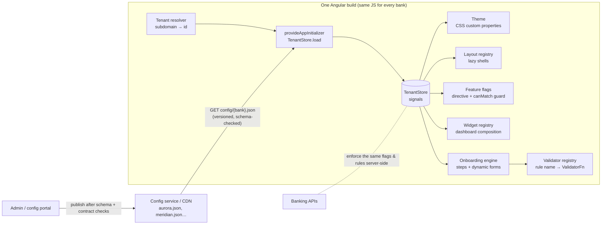

# Part B: Multi-Bank Custom UI Engine

**The short answer:** ship **one build** that knows how to render *any* bank, and treat each bank as
**data**: a versioned JSON config loaded at runtime. The code holds a fixed set of building blocks
(layouts, widgets, form fields, validation rules, features). A bank's config chooses which blocks to
use, how to arrange them and how they look. Onboarding a new bank, or changing an existing one, is a
config change, not a deployment.

A minimal working version of this lives in [`src/app/part-b/`](../src/app/part-b). Run
`npm start`, then use the "Demo bank" switcher, or open `/?bank=aurora` or `/?bank=meridian`. The
same bundle changes theme, layout, navigation, dashboard, onboarding steps and validation rules
without a rebuild.

---

## Architecture



## 1. One codebase supports all banks

**Tenant resolution.** Each bank gets its own domain (`aurora.bank.example.com`) and the app works
out the tenant from the hostname at startup. Every bank is served exactly the same static bundle.
`?bank=` is a demo and QA override, and the id is restricted to a safe slug because it ends up in
a URL ([`tenant-config.ts`](../src/app/part-b/tenant/tenant-config.ts)).

**Config is loaded before the first render.** `provideAppInitializer(() => inject(TenantStore).load())`
fetches the bank's config before bootstrap finishes, so guards, routes and theme all see the right
bank from the first frame and nothing flashes unbranded. For a faster first paint in production,
the config can also be inlined into `index.html` by the edge or CDN, or cached by a service worker
and revalidated in the background.

**A typed, versioned contract** ([`tenant.model.ts`](../src/app/part-b/tenant/tenant.model.ts)):

```ts
interface TenantConfig {
  version: number;                          // schema version, so old apps reject configs they can't read
  id: string; name: string;
  theme: ThemeTokens;                       // colours, radius, font
  layout: 'sidebar' | 'topnav';             // key into the layout registry
  features: Partial<Record<FeatureKey, boolean>>;
  dashboard: { widgets: string[] };         // keys into the widget registry, in order
  onboarding: { steps: OnboardingStep[] };  // steps → fields → validation rules
}
```

**Fail safe, not fail open.** The config is validated at the boundary (`parseTenantConfig`). If a
bank's config is missing or invalid, the app falls back to the default config, and then to a
built-in "safe mode" with every optional feature off. A typo in one bank's JSON degrades that
bank. It never white-screens it or exposes a feature that should be off.

**Config is data, never code.** Configs choose from things the code already contains. They never
contain HTML, JS or template strings to evaluate. That keeps CSP strict, avoids XSS through
config, and means everything a bank can do has been code-reviewed and tested once for all banks.

## 2. UI changes dynamically per bank

| Need | Mechanism | In the demo |
|---|---|---|
| **Branding** | Theme tokens (colour, font, radius) are written to CSS custom properties on `:root`. Tailwind v4 `@theme inline` maps utilities such as `bg-brand`, `text-brand/70`, `font-sans` and `rounded-brand` to those variables, so **one compiled stylesheet themes every bank**. Components never hard-code brand colours. Switching bank is a repaint, not a rebuild. | `applyTheme()` in [`tenant-config.ts`](../src/app/part-b/tenant/tenant-config.ts), [`styles.css`](../src/styles.css) |
| **Layouts** | A **layout registry** maps a config key to a lazily loaded shell component, which the root renders with `NgComponentOutlet`. A bank only downloads its own layout. Adding a layout is one component plus one registry line. | [`layout-registry.ts`](../src/app/part-b/layout/layout-registry.ts), [`app.ts`](../src/app/app.ts) |
| **Screen composition** | A **widget registry** works the same way for content. The dashboard is assembled from `config.dashboard.widgets`, in order. Unknown keys are skipped, so config can run ahead of a deploy without breaking anything. | [`dashboard.ts`](../src/app/part-b/dashboard/dashboard.ts), [`widget-registry.ts`](../src/app/part-b/dashboard/widget-registry.ts) |
| **Onboarding flows** | A **step engine**: config lists steps, each step lists fields, and a generic wizard builds typed reactive `FormGroup`s per step. Step order, number of steps, fields, hints and copy are all data. `linkedSignal` resets the wizard if the bank changes. | [`onboarding.ts`](../src/app/part-b/onboarding/onboarding.ts) |
| **Validation rules** | A **validator registry** maps rule names (`required`, `minLength`, `pattern`, `bvn`, `nigerianPhone`, `minAge`, …) to Angular `ValidatorFn`s. Banks choose rules, arguments and their own error messages. A new *kind* of rule is a code change, made once and available to every bank. | [`validator-registry.ts`](../src/app/part-b/onboarding/validator-registry.ts) |
| **Copy and language** | The same approach applies to copy: per-tenant translation overrides layered on top of base i18n strings. This isn't in the demo. | n/a |

The demo has three fictional banks that differ on every one of these:
[`default`](../public/config/default.json), [`aurora`](../public/config/aurora.json) (sidebar layout,
3-step KYC with minimum age 18, no loans), and [`meridian`](../public/config/meridian.json) (top
nav, a business onboarding with CAC number validation and a sector select, no cards or savings).

Because everything reads from signals in `TenantStore`, the UI also re-renders live when the config
changes at runtime. You can see this with the demo bank switcher.

## 3. Features enabled or disabled per bank

Flags live in `config.features`, and they are **opt-in**: a missing or unknown key counts as off.
They're enforced at three levels:

1. **Routes:** a `canMatch` guard ([`feature-guard.ts`](../src/app/part-b/features/feature-guard.ts)).
   A disabled feature's route never matches, so its **lazy chunk is never downloaded**, and a deep
   link redirects to a proper "not available" page.
2. **UI:** a structural directive, `*appIfFeature="'loans'"`
   ([`if-feature.ts`](../src/app/part-b/features/if-feature.ts)), plus the nav, which is computed
   from enabled features. Widgets can declare a `requires` feature, so a misconfigured dashboard
   can't advertise a disabled product.
3. **Server:** the API enforces the same flags. Frontend flags are a UX boundary, not a security
   boundary.

For gradual rollouts (a percentage of users, internal staff only, A/B tests), the boolean can grow
into a rule evaluated by the config service or a flag provider such as LaunchDarkly or Unleash. The
`isEnabled()` interface doesn't change.

## Keeping it safe at 10+ banks

- **Schema plus contract tests in CI.** The same TypeScript types drive a JSON Schema the config
  service validates against before publishing. The repo also has a contract test
  ([`tenant-config.spec.ts`](../src/app/part-b/tenant/tenant-config.spec.ts)) that loads every
  bank's config and fails if it references a widget or validation rule the build doesn't know.
- **Versioning.** `version` is checked on load. Breaking schema changes bump it, and the config
  service can serve both versions during a rollout.
- **Caching.** Configs sit on a CDN with a short TTL and `ETag`. Changes go live in minutes and
  can be rolled back by republishing the previous version.
- **Performance.** Every registry entry is a lazy `import()`, and features use `canMatch`, so each
  bank only downloads what it actually uses. Heavier blocks can use `@defer (on viewport)`.
- **Testing.** Each building block is tested once, generically. The contract tests guarantee each
  bank only composes blocks that exist, and a small visual-regression run per tenant catches
  branding mistakes.

## What I'd add with more time

- A JSON Schema generated from the TS types, plus an admin preview: load a draft config into the
  live app before publishing.
- Conditional onboarding steps (for example, "show the business step only if account type =
  business"), using the same rule-by-name approach so there's no `eval`.
- Per-tenant i18n overrides, and design-token sets beyond colour (spacing, density, dark mode).
